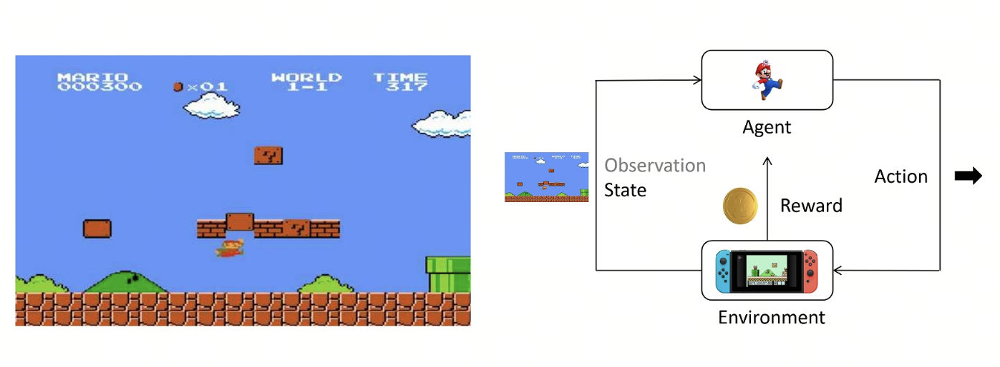
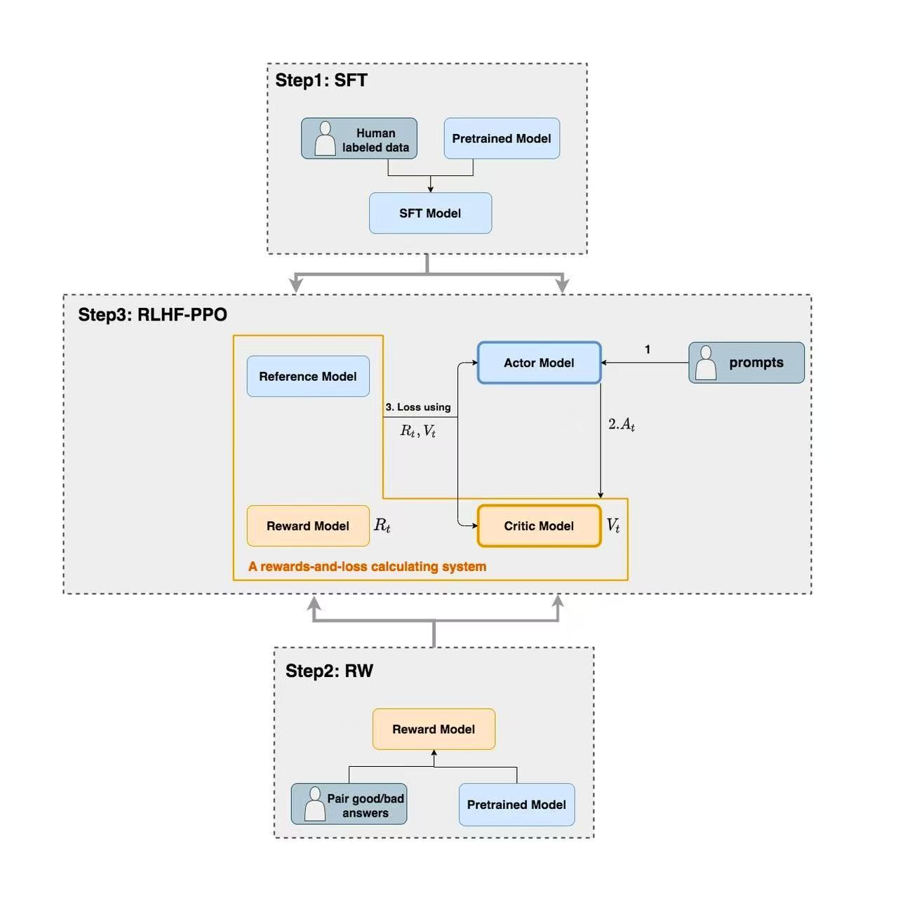
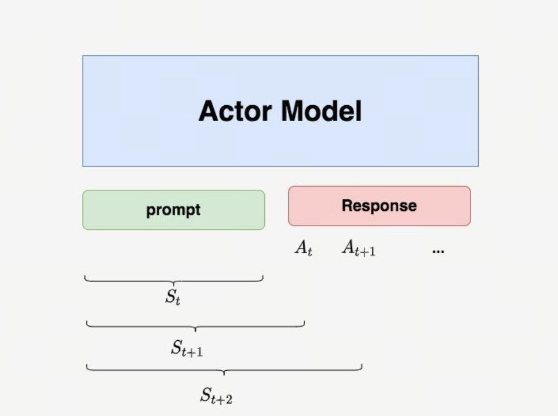
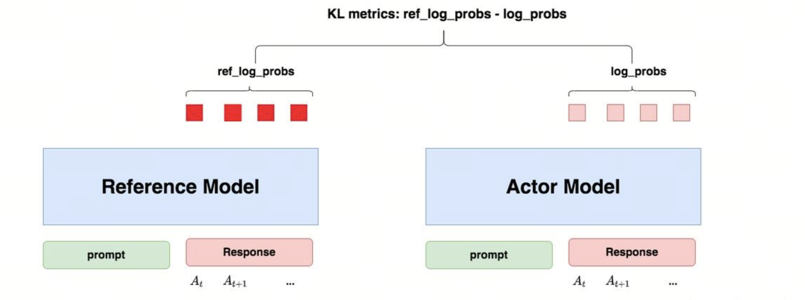
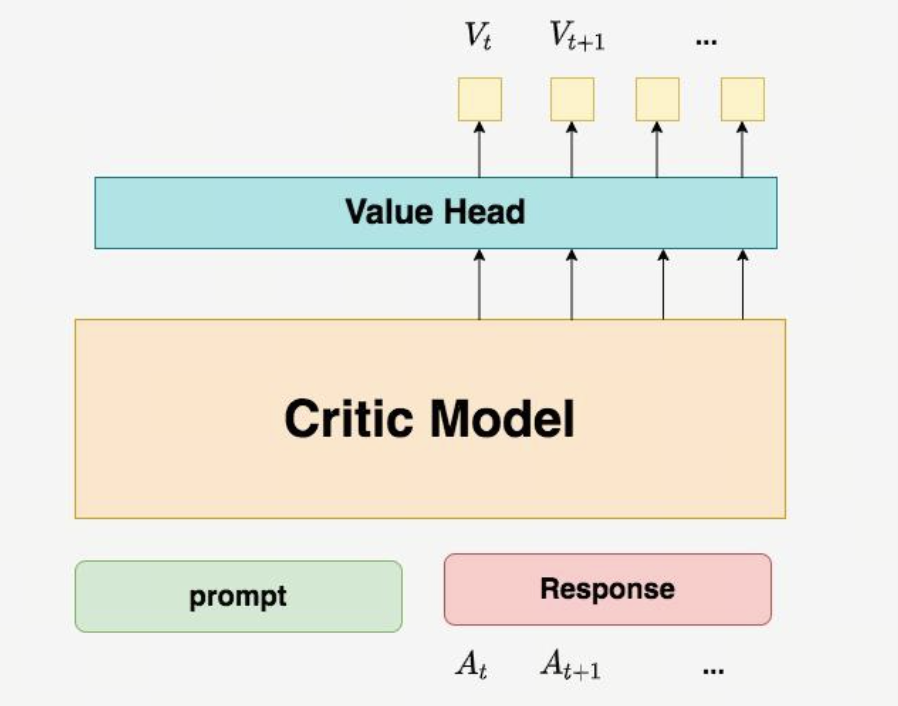
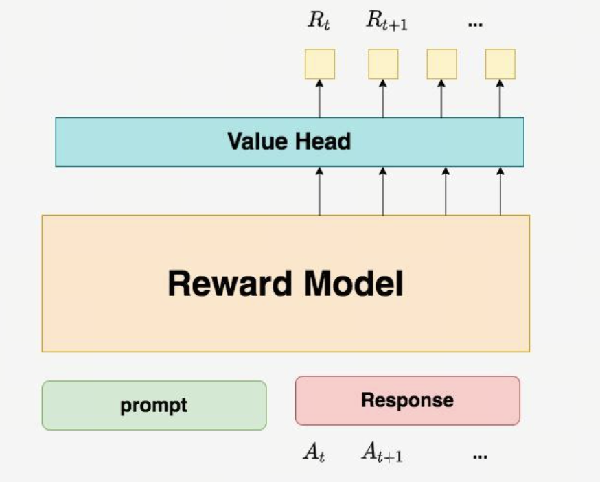
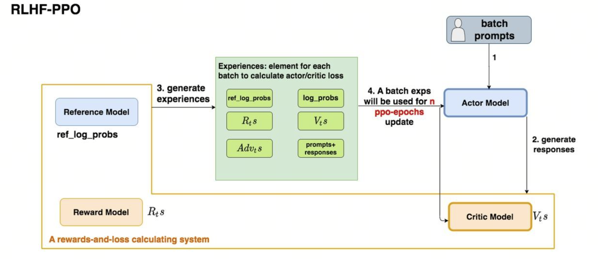

# 第15课时：对齐算法原理 (RLHF & GRPO)

## 第一部分：RLHF 基础：Reward Model (RM) 与 PPO (Proximal Policy Optimization)

### 1.1 PPO 定义与背景

**PPO（近端策略优化）** 是一种强化学习（Reinforcement Learning, RL）算法，由 OpenAI 于 2017 年提出。它属于 **策略梯度（Policy Gradient）** 方法的一种。在大模型的训练序列中（预训练 -> SFT -> 强化学习），PPO 扮演着将人类偏好注入模型的关键角色。

### 1.2 训练阶段详解

#### 1.2.1 预训练阶段 (Pre-training)
大语言模型通过在一个大型的通用数据集上通过无监督学习的方式进行预训练来学习语言的表征/初始化模型权重/学习概率分布。期望在预训练后模型能够处理大量、多种类的数据集，进而可以通过监督学习的方式来微调模型使其适应特定的任务。

#### 1.2.2 无监督学习（Unsupervised Learning）
主要研究如何让计算机在缺乏外部显式指导（即没有人工标注的标签或目标值）的情况下，通过对输入数据的统计分布、结构特征或内在联系进行建模，从而自动发现数据中隐藏的模式、结构或知识。

#### 1.2.3 监督学习（Supervised Learning）
利用一组已知类别的训练样本（即输入数据及其对应的标签）来训练模型，使其能够学习到输入与输出之间的映射关系。在监督学习中，每个训练实例都由一个输入对象（通常是向量）和一个期望的输出值（称为标签或目标）组成。

#### 1.2.4 监督微调（SFT，Supervised Fine-Tuning）
属于监督学习的范畴，是一种在预训练模型上使用小规模有标签数据集进行训练的方法。相比于预训练一个全新的模型，对已有的预训练模型进行监督微调是更快速更节省成本的途径。

#### 1.2.5 强化学习（RL）
研究智能体（Agent）如何在复杂、不确定的环境（Environment）中，通过"试错(Trial and Error) 的交互方式，学习一套最优的策略 (Policy)，以实现在长期交互过程中获得的累积奖励（Cumulative Reward）最大化。

### 1.3 强化学习核心要素

1. **智能体 (Agent)**：模型本身（比如多模态大模型）。

2. **环境 (Environment)**：外界指令、图片以及对话上下文。

3. **动作 (Action)**：模型生成的下一个 Token 或整句回复。

4. **状态 (State)**：当前对话进行到了哪一步，图片长什么样。

5. **奖励 (Reward)**：评价模型表现的分数（由 奖励模型 给出）。

用强化学习核心要素总结以下循环图： 马里奥（智能体）看到当前的屏幕画面（状态），决定向上跳跃（动作），这个动作作用于游戏世界（环境）后，顶到了砖块并获得了一枚金币（奖励），同时游戏画面更新到了下一帧(新状态）。

简单来说，结合强化学习的概念，PPO 的核心目的是：在训练智能体（Agent）时，既要让它不断学习变得更好，又要防止它步子迈得太大而“跌倒”（模型崩溃），实现奖励最大化 和 步长最小化。

### 1.4 为什么在 LLM 中如此重要？
在当代大语言模型训练中，强化学习主要应用于 RLHF (Reinforcement Learning from Human Feedback) 阶段：利用 PPO 等算法，根据奖励模型（Reward Model）提供的偏好分数，微调 SFT 后的模型，使其生成的回复在安全性、真实性和逻辑性上与人类价值观对齐。

即便 SFT 已经能让模型学会听懂指令并规范对答，PPO 阶段仍然不可或缺，主要原因如下：

A. 解决“模仿”的局限性（超越标注者）

SFT 本质上是让模型做“复读机”，学习人类给出的特定回答。但在很多复杂问题下，并没有唯一的标准答案。PPO 允许模型在广阔的可能回答空间中进行**探索（Exploration）**，通过奖励信号发现那些人类可能写不出来、但逻辑更优或更符合偏好的表述方式。

B. 更好的“对齐”人类价值观（Alignment）

人类对“好回答”的感知往往是综合的（例如：语气要诚恳、逻辑要严密、不能带有偏见）。

SFT 的局限：很难通过简单的“模仿”来教会模型这些微妙的偏好。

PPO 的优势：奖励模型可以捕捉人类复杂的偏好（如安全、诚实、有用），PPO 则利用这些打分作为导航，让模型在生成的过程中不断向这些价值观靠拢。

C. 抑制“幻觉”与提升诚实度

在 SFT 阶段，模型可能会为了模仿标注数据中的特定风格而编造事实。而在 PPO 阶段，如果奖励模型对“虚假信息”给予严厉的负分（负奖励），PPO 算法就会强制模型在遇到不确定的事实时选择说“我不知道”，从而有效减少幻觉。

## 第二部分：PPO 训练中的详细工作流程

PPO 训练可以分为三个主要阶段：生成与收集 (Rollout)、评估与打分、优化与更新。

在 PPO（Proximal Policy Optimization，近端策略优化）算法中，通常存在四个关键角色，分别是**Actor（Policy model)、Ref Model(Reference Model)、Reward Model、Critic(Value Model)**，将依次介绍各个角色在流程中发挥的作用。

### 2.1 PPO/RLHF 流程中的四个模型协作图

这张流程图展示了大语言模型（LLM）训练中经典的**强化学习人类反馈（RLHF）**三阶段过程，主要参考了 OpenAI 在 InstructGPT 中使用的经典范式。

以下是针对图中三个核心步骤的详细解释：

#### 2.1.1 Step 1: SFT (Supervised Fine-Tuning, 有监督微调)

这是训练的起点，旨在让预训练模型学会遵循人类指令。

* **输入**：预训练模型（Pretrained Model）和人工标注的数据（Human labeled data，通常是"指令-回答"对）。

* **过程**：在高质量的人工示范数据上进行微调。

* **输出**：得到 **SFT 模型**，它初步具备了对话和执行任务的能力。

#### 2.1.2 Step 2: RW (Reward Modeling, 奖励模型训练)

这一阶段是为了构建一个"打分器"，用来模拟人类的偏好。

* **输入**：SFT 后的模型生成的多个答案，由人类对这些答案进行排序或标注（Pair good/bad answers）。

* **过程**：利用这些偏好数据训练一个**奖励模型（Reward Model）**。

* **输出**：奖励模型能够对任何给定的回答输出一个标量分数（Reward），分数越高代表回答越符合人类偏好。

#### 2.1.3 Step 3: RLHF-PPO (Reinforcement Learning from Human Feedback)

这是最复杂的阶段，利用近端策略优化（PPO）算法进一步对齐模型。图中展示了四个子模型之间的协作：

* **Actor Model（演员模型）**：即正在优化的模型。它接收 Prompt（提示词），产生动作 $A_t$（即生成的文本）。

* **Reference Model（参考模型）**：通常是一个冻结参数的 SFT 模型，用于计算 KL 散度，防止 Actor 模型在强化学习过程中为了刷分而变得"面目全非"。

* **Reward Model（奖励模型）**：计算生成的回答在人类偏好下的得分 $R_t$。

* **Critic Model（评论家模型）**：预测当前状态的价值 $V_t$（期待的总奖励），帮助模型更稳定地学习。

**核心逻辑循环：**

1. **Prompts (1)** 输入到 Actor。

2. **Actor 生成回答 (2)**。

3. **系统计算 Loss (3)**：综合奖励信号 $R_t$ 和价值预测 $V_t$。通过计算出的损失函数来更新 Actor 和 Critic 模型的参数，使模型最终能够生成既符合逻辑又满足人类偏好的高质量内容。

### 2.2 阶段一：生成与收集 (Rollout)

🎯 目标：让 Policy Model 与环境互动，收集一批数据。

| 模型 | 角色 | 输入 | 输出 | 关键操作 |
| :--- | :--- | :--- | :--- | :--- |
| **Actor Model** (Policy Model) | **生成者** | Prompt (提示词) | Response (生成的回复文本) | 使用当前策略 $\pi_{\theta}$ 生成回复。参数在训练中**持续更新**，旨在最大化奖励。 |
| **Reference Model** | **锚定者** | Prompt + Response | Log Probabilities (原始对数概率) | **参数冻结**。通过计算 KL 散度约束 Actor，防止模型坍缩或过度拟合奖励模型（Reward Hacking）。 |
| **Reward Model** | **打分者** | Prompt + Response | Reward Score (奖励分) | **参数冻结**。模拟人类偏好，为生成的文本质量提供量化的反馈信号。 |
| **Critic Model** | **评估者** | Prompt + Response | State Value (状态价值 $V$) | **参数更新**。学习预测当前回复的预期收益，用于计算优势函数（Advantage）以降低方差。 |

实际 PPO 更新还需要保存生成回答的旧策略逐 token 对数概率、旧价值估计、奖励与有效 token mask。参考策略概率用于 KL，不能替代旧策略概率构造 PPO 分母。

 

PPO生成阶段的KL约束机制 - Actor模型生成回复，Reference模型计算基准概率，两者对比产生KL惩罚，防止模型过度偏离原分布。

Rollout数据收集结果 - 展示三元组(Prompt, Response, Reference Log Probs)，为Reward Model和Critic Model的后续评估提供基础数据。

#### 2.2.1 概念解析

**什么是 Actor（行动者）？**

在标准的强化学习框架中，Actor 是负责做出决策的实体。它观察当前的环境状态 $s$，然后根据某种概率选择一个动作 $a$。

在大模型 PPO 中：Actor 就是你正在微调的那个**语言模型（LLM）**。

* 输入（状态）：提示词加上当前已经生成的回答前缀。

* 动作（Action）：模型生成的下一个 Token（词片段）。

* 目标：Actor 的任务是学会生成那些能够获得高奖励（即人类更喜欢、更准确）的回复。

**什么是策略（Policy）？**

策略（通常用 $\pi$ 表示）是 Actor 内部的“决策逻辑”或“说明书”。它定义了在特定状态下选择某个动作的概率分布。

公式表达：$$ \pi(a|s) $$

即在状态 $s$ 下采取动作 $a$ 的概率。

在 LLM 中的体现：

1. 模型在生成文本时，会对词表中的每个词计算一个概率（Softmax 后的结果）。

2. 这个全词表的概率分布就是当前的策略。

3. 训练的目的：通过 PPO 算法不断调整模型的权重，使得“好词”的出现概率变大，“坏词”或“幻觉词”的出现概率变小。

**什么是 KL 散度？**

简单来说，KL 散度（Kullback-Leibler Divergence） 是衡量两个概率分布 $P$ 和 $Q$ 之间“差异程度”的一个指标。

在机器学习和强化学习中，我们通常用 $P$ 代表真实分布（或目标分布），用 $Q$ 代表模型预测的分布。KL 散度告诉我们：
如果我们用分布 $Q$ 来近似分布 $P$，会损失多少信息？

**数学定义：**

对于离散变量，$D_{KL}(P\parallel Q)$ 表示以 $P$ 加权、相对于 $Q$ 的散度；其方向应按公式识别：

$$ D_{KL}(P \parallel Q) = \sum_{x \in X} P(x) \log \left( \frac{P(x)}{Q(x)} \right) $$

通过对数换算，它可以拆解为：

$$ D_{KL}(P \parallel Q) = \sum P(x) \log P(x) - \sum P(x) \log Q(x) $$

当 $P(x)>0$ 而 $Q(x)=0$ 时散度为无穷大；以下策略公式假设相关概率非零。

关键特性：不对称性

>$$ D_{KL}(P \parallel Q) \neq D_{KL}(Q \parallel P) $$

这就是为什么它被称为“散度”而不是“距离”。在训练模型时，参照物是谁非常重要。

**两个模型的关系**

* **Actor (Policy Model)**：它是我们的最终目标模型。在训练过程中，它的参数会随着优化器不断更新。它变得越来越会"讨好"奖励模型（Reward Model）。

* **Ref Model**：它是基座模型的一个备份，参数是完全冻结的。

如果只有 Actor 和 Reward Model，Actor 很快就会发现一些"捷径"。比如，如果奖励模型喜欢长句子，Actor 可能会学会一直重复无意义的词来拉长篇幅（这叫 Reward Hacking）。Ref Model 的存在是为了计算 KL 散度：它要求 Actor 在追求高分的同时，生成的概率分布不能偏离 Ref Model 太远。这保证了模型在变聪明的同时，仍然保持着人类语言的基本逻辑。

**概率对齐（Logits 计算）**

当 Actor 生成完一段话后，为了后续的训练，我们需要知道：

1. Actor Logits：针对刚刚生成的这段话，Actor 自己认为每个 Token 出现的概率是多少？

2. Ref Logits：针对同一段话，那个“没被训练过”的 Ref Model 认为每个 Token 出现的概率应该是多少？
公式化表达：

这一步会产生一个 KL 惩罚项：

如果 Actor 给某个词的概率远高于 Ref Model，这个惩罚值就会变大，抵消掉一部分奖励。

### 2.3 阶段二：评估与打分

🎯 目标：用 Reward Model 和 Value Model 给生成的数据打分。

 

Reward Model评估机制 - RM作为最终裁判，对完整Prompt+Response序列输出标量分数，代表人类偏好程度。

 

Critic Model预测机制 - VM作为实时评论员，预测当前状态的预期总收益，用于降低训练方差和计算优势函数。

#### 2.3.1 核心概念与角色定义

在 PPO 训练中，我们需要两个评分模型，它们分别代表"现实的反馈"和"预期的判断"。

**Reward Model (RM)**

* **性质**：通常是一个基于 BERT 或 Llama 的分类/回归模型，**参数冻结**（不参与训练）。

* **输入**：完整的 Prompt + Response 序列。

* **输出**：一个标量分数。

* **作用**：提供 Ground Truth（基准事实），告诉系统这条生成结果最终符合人类偏好的程度。

**Value Model (VM / Critic) —— 实时评论员**

* **性质**：与 Actor 共享大部分参数（或独立网络），**参数动态更新**。

* **输入**：当前的 Token 序列状态 $s_t$。

* **输出**：一个标量预测值 $V(s_t)$。

* **作用**：预测从当前状态 $s_t$ 开始，一直写到结束，预期能获得多少总收益。它是用来降低训练方差的关键工具。

#### 2.3.2 奖励流的构建 (The Reward Function)

对于完整回答的有效 token $t=1,\ldots,T$，保存采样策略 $\pi_{\mathrm{old}}$ 与参考策略的 log probability。一种常见的 RLHF-PPO 奖励构造为：

$$
r_t=-\beta\log\frac{\pi_{\mathrm{old}}(a_t\mid s_t)}{\pi_{\mathrm{ref}}(a_t\mid s_t)}
+\mathbf1\{t=T\}R_{\mathrm{score}}.
$$

$s_t$ 包含 prompt 和回答前缀，$R_{\mathrm{score}}$ 是整段回答的奖励模型得分；终点打分只加一次。该逐 token log 比在当前采样策略下的期望对应 KL，单个 token 上可以为负，并不等于精确的非负 KL。完成 rollout 后，在同一批次多轮更新期间固定这些奖励、旧策略概率和优势，不通过它们反向传播。[InstructGPT, §3](https://arxiv.org/abs/2203.02155)

#### 2.3.3 TD、MC 与 GAE

先区分真实终止与采样截断。令 $d_t=1$ 表示动作后到达真实终止状态；普通转换的 TD 残差为：

$$
\delta_t=r_t+\gamma(1-d_t)V_{\mathrm{old}}(s_{t+1})-V_{\mathrm{old}}(s_t).
$$

完整终止轨迹的折扣回报为：

$$
G_t=\sum_{l=0}^{T-t}\gamma^l r_{t+l}.
$$

这是给定采样策略下折扣回报的 Monte Carlo 样本，不表示奖励模型分数是真实人类价值。对于仅因采样窗口或时间上限截断的轨迹，是否 bootstrap 取决于任务定义；不能一律把末状态价值设为零。

对一条完整终止轨迹，GAE 写为：

$$
\hat A_t^{\mathrm{GAE}}=\sum_{l=0}^{T-t}(\gamma\lambda)^l\delta_{t+l}.
$$

实现时令 $b_t=1$ 表示下一条转换仍属于同一条已收集轨迹，反向递推：

$$
\hat A_t=\delta_t+\gamma\lambda b_t\hat A_{t+1},\qquad \hat A_{T+1}=0.
$$

真实终止后的 bootstrap 被 $1-d_t$ 屏蔽；收集片段边界的优势递推由 $b_t$ 截断。这两个 mask 的含义不同。GAE 由 [Schulman et al., §3](https://arxiv.org/abs/1506.02438) 提出，不是 PPO 专有算法。$\lambda=0$ 给出一步 TD 残差；完整终止轨迹上 $\lambda=1$ 时，望远镜求和得到 $\hat A_t=G_t-V_{\mathrm{old}}(s_t)$，而不是直接等于 $G_t$。

#### 2.3.4 Critic 目标与优化边界

常见的 $\lambda$-return 目标为：

$$
V_t^{\mathrm{target}}=\operatorname{stopgrad}
\left(\hat A_t+V_{\mathrm{old}}(s_t)\right).
$$

它是根据旧价值预测构造的训练目标，不是“真实价值”的精确标签。也有教学实现选择一步 TD target 拟合 Critic；必须明确采用的版本，不能把两者混为一谈。padding、prompt token 与无效转换不计入回答的策略损失。

#### 2.3.5 参数说明

$\gamma\in[0,1]$ 控制折扣，$\lambda\in[0,1]$ 控制 TD 残差的多步组合，$\beta\geq0$ 控制参考策略正则。具体取值依赖奖励尺度、任务长度和实现；GAE 的偏差/方差取决于价值近似和轨迹截断，不能保证某个参数必然使训练稳定。

#### 2.3.6 总结：RM 与 VM 的区别图谱
| 维度 | Reward Model (RM) | Value Model (VM) |
| :--- | :--- | :--- |
| **核心逻辑** | 基于结果 (Outcome-based) | 基于预期 (Prediction-based) |
| **打分频率** | 每条数据 1 次 (Sparse) | 每个 Token 1 次 (Dense) |
| **信息来源** | 人类偏好数据 (训练前定死) | 自身策略的历史表现 (训练中自适应) |
| **在公式中的位置** | 构成 $r_T$ (奖励源头) | 构成 $\delta$ 和 $A_t$ (基线 Baseline) |
| **如果没有它** | 模型不知道什么是“好” | 训练方差太大，无法收敛，或者只能用简单的 MC 方法 |

### 2.4 在大模型 PPO 中的 AC 架构

#### 2.4.1 AC 架构（Actor-Critic Architecture，演员-评论家架构） 

是强化学习 RL 中目前最流行、最强大的架构模式之一。包括 PPO在内的许多现代 RL 算法，本质上都是基于 AC 架构的。

在 LLM 的 PPO 训练中，AC 架构的具体形态通常如下：

__结构：Hydra（九头蛇）模式__

由于 Actor（语言模型）和 Critic（价值评估）都需要理解文本语义，通常不会训练两个完全独立的巨大网络。

* 共享主干（Shared Backbone）：Qwen/Llama 的 Transformer 主体部分。
    
* Actor Head：原本的 lm_head（线性层），输出维度 = 词表大小（几万到十几万），用于生成。

* Critic Head (Value Head)：新增的一个线性层，输出维度 = 1，用于打分。

__交互流程__：

1. Actor 看到 Prompt，生成回答。
2. Critic 看着 Actor 生成的每一个词，预测：“目前的走势，最后大概能得 80 分。”
3. 环境 给出真实反馈（比如到了某个词，违反了规则，扣分）。
4. 计算优势（Advantage）：
        如果 A > 0：说明 Actor 表现得比 Critic 预期的好（惊喜）-> Actor 强化这个动作。
        如果 A < 0：说明 Actor 表现得比 Critic 预期的差（失望）-> Actor 抑制这个动作。
5. Critic 自我反思：根据真实结果修正自己的预测能力，争取下次猜得更准。

### 2.5 阶段三：优化与更新（Optimization）

#### 2.5.1 目标：使用 PPO 算法，根据分数调整 Policy Model。

 

在 PPO 的更新阶段，我们实际上是在计算一个总损失（Total Loss），然后通过反向传播（Backpropagation）来同时更新 Actor 和 Critic 的参数。为了便于理解，我们通常采用最小化损失的视角。

#### 2.5.2 PPO 总损失公式

本节统一使用**最小化**的损失记法。以独立 Actor 参数 $\theta$ 和 Critic 参数 $\phi$ 为例：

$$
L_{\mathrm{total}}(\theta,\phi)=L_{\mathrm{actor}}(\theta)
+c_1L_{\mathrm{value}}(\phi)-c_2\mathbb E_t[H(\pi_\theta(\cdot\mid s_t))].
$$

$c_1,c_2\geq0$，$\mathbb E_t$ 表示 rollout 中有效状态/动作的经验平均。熵项是可选项，不是所有 LLM PPO 实现都使用。这里的 KL 已进入奖励和优势，不应在无意中重复计入另一份惩罚。[PPO, §3](https://arxiv.org/abs/1707.06347)

#### 2.5.3 策略损失 (Actor Loss)

$$
\begin{aligned}
\rho_t(\theta)&=\frac{\pi_\theta(a_t\mid s_t)}{\pi_{\mathrm{old}}(a_t\mid s_t)},\\
L_{\mathrm{actor}}(\theta)&=-\mathbb E_t\left[
\min\left(\rho_t(\theta)\hat A_t,
\operatorname{clip}(\rho_t(\theta),1-\epsilon,1+\epsilon)\hat A_t\right)\right].
\end{aligned}
$$

概率比写成 $\rho_t$，避免与即时奖励 $r_t$ 混淆。旧策略是生成这批回答的策略，与用于 KL 的参考策略职责不同。

- 当 $\hat A_t>0$，$\rho_t>1+\epsilon$ 的有利增加被裁剪项封顶。
- 当 $\hat A_t<0$，$\rho_t<1-\epsilon$ 的有利减少被裁剪项封顶。
- 不利方向的变化仍保留惩罚；这不是把所有实际概率比强行约束在区间内，也不是训练稳定性的保证。

同一批次更新中 $\pi_{\mathrm{old}}$ 与 $\hat A_t$ 固定，不参与反向传播。

#### 2.5.4 价值损失 (Value Loss)

$$
L_{\mathrm{value}}(\phi)=\mathbb E_t\left[
\left(V_\phi(s_t)-V_t^{\mathrm{target}}\right)^2\right].
$$

当前 $V_\phi$ 参与梯度计算，目标值固定。若使用 value clipping 或共享 Actor/Critic 参数，需要另外说明实现，不能把上式当作所有 PPO 变体的完整损失。

#### 2.5.5 熵奖励 (Entropy Bonus) —— 鼓励探索

这是公式中的“惩罚项”，但在 loss 中用减号表示，所以实际上是奖励。

$$ H(\pi_\theta(\cdot\mid s))=-\sum_a\pi_\theta(a\mid s)\log\pi_\theta(a\mid s). $$

__什么是熵 (Entropy)？__：衡量概率分布的“混乱程度”或“不确定性”。

- 如果模型对某个动作 100% 确定，熵 = 0。

- 如果模型在几个动作之间犹豫不决（均匀分布），熵最大。

__为什么要减去熵？（即最大化熵）__：在训练初期，我们不希望 Actor 过早地“迷信”某一个动作（过早收敛到局部最优）。通过在 Loss 里加入这一项，我们强迫模型保持一定的“随机性”和“好奇心”，去尝试那些它没试过的词。

$c_2$：熵系数（通常很小，如 0.01），随着训练进行通常会衰减。

__计算 KL 散度惩罚__:比较 Policy Model 生成的 Log Probabilities 和 Reference Model 生成的 Log Probabilities。如果差异太大，PPO 会给最终奖励 $r$ 施加一个惩罚项，确保模型在学习新策略时不会发散（防止跑偏）。

PPO 优化:最终，PPO 使用包含 截断（Clipping） 机制和 KL 惩罚 的目标函数，通过梯度下降同时更新：

- Policy Model (Actor) 的参数（使其生成更高奖励的回复）。

- Value Model (Critic) 的参数（使其能更准确地预测状态价值）。
这个三阶段循环不断重复，直到 Policy Model 的回复在满足人类偏好的同时，还能保持其基础的语言能力。

## 第三部分：直接偏好优化：DPO (Direct Preference Optimization), IPO, KTO 原理对比

随着大语言模型对齐技术的演进，传统的 PPO 流程因其训练复杂性和高资源消耗（需要维护 Actor、Critic、Ref、Reward 四个模型）而备受挑战。学术界开始探索更轻量、更稳定的替代方案，其中 DPO (Direct Preference Optimization) 及其变体 IPO 和 KTO 成为了当前最主流的研究方向。

本部分将深入剖析这三种算法的核心数学原理，对比它们的异同与适用场景。

### 3.1 DPO (Direct Preference Optimization)：化繁为简的里程碑

**DPO (直接偏好优化)** 由 Stanford 研究团队于 2023 年提出，其核心思想是跳过显式的奖励模型（Reward Model）训练，直接利用偏好数据对策略模型进行优化。

#### 核心数学原理：从 RL 到分类问题

在 RLHF 中，我们通常假设人类偏好服从 **Bradley-Terry (BT) 模型**。对于给定的输入 $x$ 和两个回答 $y_w$（Chosen，胜者）与 $y_l$（Rejected，败者），人类偏好分布 $p^*$ 可以表示为：

$$ p^*(y_w \succ y_l | x) = \frac{\exp(r^*(x, y_w))}{\exp(r^*(x, y_w)) + \exp(r^*(x, y_l))} $$

其中 $r^*(x, y)$ 是隐含的真实奖励函数。

DPO 的推导基于 RL 的最优策略公式。对于带有 KL 散度约束的奖励最大化问题，其最优策略 $\pi^*$ 与最优奖励函数 $r^*$ 存在如下解析关系：

$$ r^*(x,y)=\beta\log\frac{\pi^*(y\mid x)}{\pi_{\mathrm{ref}}(y\mid x)}+\beta\log Z(x). $$

* $\beta$：KL 惩罚系数，控制偏离参考模型的程度。

* $Z(x)=\sum_y\pi_{\mathrm{ref}}(y\mid x)\exp(r^*(x,y)/\beta)$：配分函数。可消去的是两个回答间相同的 $\beta\log Z(x)$ 项，而不是直接把 $Z(x)$ 加到奖励上。[DPO, 式 (4)–(7)](https://arxiv.org/html/2305.18290v3)

将这个关系代入 BT 模型公式，消去难算的 $Z(x)$，我们可以直接得到仅包含策略模型 $\pi_{\theta}$ 和参考模型 $\pi_{\text{ref}}$ 的目标函数：

$$ L_{\text{DPO}}(\pi_{\theta}; \pi_{\text{ref}}) = - \mathbb{E}_{(x, y_w, y_l) \sim D} \left[ \log \sigma \left( \beta \log \frac{\pi_{\theta}(y_w|x)}{\pi_{\text{ref}}(y_w|x)} - \beta \log \frac{\pi_{\theta}(y_l|x)}{\pi_{\text{ref}}(y_l|x)} \right) \right] $$

$L_{DPO}$:

- DPO 算法的损失函数值。

- 最小化该损失会增大胜出回答与失败回答之间的隐式奖励差距。

$π_θ ()$:

- 当前正在训练的目标策略模型。

- 目标是学习一个参数 $θ$，使得模型输出更符合人类偏好的 $y_w$。

$π_{ref} ()$:

- 预训练好的参考模型（通常是经过 SFT 的模型）。

- 参数在训练期间保持冻结，作为正则化的基准，防止模型产生灾难性遗忘或模式崩坏。

$(x, y_w, y_l) \sim D$:

- 数据集中的偏好对。$x$ 为输入提示词，$y_w$ 为胜出回答，$y_l$ 为失败回答。

$β (beta)$:

- 调节参数（超参数）。

- 控制对参考模型 $π_{ref}$ 偏离程度的惩罚力度。$β$ 越大，对偏离的惩罚越重，模型越保守。

$log(π_θ(y|x) / π_{ref}(y|x))$:

- 隐式奖励（Implicit Reward）。

- DPO 的核心思想：某回答的奖励与其在当前模型与参考模型间的对数概率比值成正比。

$σ (sigma)$:

- Sigmoid 激活函数。

- 将两个回答的隐式奖励差值映射到 (0, 1) 区间，将其转化为一个二分类概率问题。

$-\mathbb E[\log\sigma(\cdot)]$ 是要最小化的负对数似然；不能省略负号后仍称为该损失。

#### DPO 的直观理解
这个公式看起来复杂，但其梯度更新的物理意义非常直观：

1.  **增加胜者概率**：如果 $\pi_{\theta}$ 对 $y_w$ 的预测概率（相对于 $\pi_{\text{ref}}$）较高，损失减小。

2.  **降低败者概率**：如果 $\pi_{\theta}$ 对 $y_l$ 的预测概率（相对于 $\pi_{\text{ref}}$）较高，损失增大。

3.  **隐式奖励**：DPO 本质上是将“奖励建模”和“策略优化”合二为一，直接通过最大似然估计来求解最优策略，从而避免了 PPO 中 Actor 和 Critic 相互拉扯的不稳定性。

#### 优缺点总结

* **优点**：

    * **极简架构**：不需要训练独立的 Reward Model，甚至不需要 Critic Model，显存占用减半。

    * **训练稳定**：本质上是一个分类任务（Cross-Entropy Loss 的变体），避免了 RL 中的高方差和超参数敏感问题。

* **缺点**：

    * **泛化性争议**：有研究指出，DPO 在分布外（OOD）数据上的泛化能力可能不如 PPO。

### 3.2 IPO (Identity Preference Optimization)：解决 DPO 的过拟合

**IPO (身份偏好优化)** 是由 Google DeepMind 提出的，旨在解决 DPO 在某些情况下容易过拟合的问题。

#### 核心数学原理：有限目标间隔

按 IPO 原论文的正则系数 $\tau>0$ 定义，令：

$$
h_\theta(x,y_w,y_l)=\log\frac{\pi_\theta(y_w\mid x)}{\pi_{\mathrm{ref}}(y_w\mid x)}
-\log\frac{\pi_\theta(y_l\mid x)}{\pi_{\mathrm{ref}}(y_l\mid x)}.
$$

IPO 最小化：

$$
L_{\mathrm{IPO}}(\theta)=\mathbb E_{(x,y_w,y_l)\sim D}
\left[\left(h_\theta(x,y_w,y_l)-\frac1{2\tau}\right)^2\right].
$$

目标间隔是 **$1/(2\tau)$，不是 $\tau/2$**；若换用其倒数作为超参数，必须显式重新定义。$h_\theta$ 是相对参考策略的对数概率差，不是未经缩放即可称作真实奖励的量。该式见 [IPO 原论文 §5.2，式 (17)](https://arxiv.org/html/2310.12036v2)。较大 $\tau$ 对应较小目标间隔；有限间隔的设计不构成对所有任务都避免过拟合的保证。

DPO 对可分偏好数据可以持续增大相对间隔；不能简单把这一现象归因为“Sigmoid 梯度消失导致过拟合”。比较 IPO/DPO 时还需统一回答 log probability 的求和或长度归一化约定。

### 3.3 KTO (Kahneman-Tversky Optimization)：非成对数据的福音

**KTO (Kahneman-Tversky 优化)** 由 Contextual AI 提出，其灵感来源于行为经济学中的 **前景理论 (Prospect Theory)**。

#### 核心痛点与解决方案

DPO 和 IPO 都依赖 **成对数据 (Pairwise Data)**，即必须有 $(x, y_w, y_l)$。然而，在实际应用中，收集这种“好坏对比”数据非常昂贵。很多时候，我们只有 **点状数据 (Pointwise Data)**：即“这个回答是好的” (Thumbs Up) 或“这个回答是坏的” (Thumbs Down)，而没有直接的对比项。

KTO 的设计初衷就是直接利用这些非成对的 $(x, y, \text{label})$ 数据进行训练。

#### 核心数学原理

KTO 需要标签 $\ell\in\{D,U\}$，分别表示 desirable 和 undesirable。为与 [KTO 原论文 §4.1，式 (8)](https://arxiv.org/html/2402.01306v3) 一致，令未乘 $\beta$ 的对数概率比为：

$$
r_\theta(x,y)=\log\frac{\pi_\theta(y\mid x)}{\pi_{\mathrm{ref}}(y\mid x)},\qquad
z_0(x)=D_{\mathrm{KL}}(\pi_\theta(\cdot\mid x)\|\pi_{\mathrm{ref}}(\cdot\mid x)).
$$

将原论文 $\lambda_y-v(x,y)$ 展开，最小化的等价分段损失为：

$$
\begin{aligned}
L_{\mathrm{KTO}}&=\mathbb E_{(x,y,\ell)\sim D}[\ell_{\mathrm{KTO}}(x,y,\ell)],\\
\ell_{\mathrm{KTO}}&=
\begin{cases}
\lambda_D[1-\sigma(\beta(r_\theta-z_0))],&\ell=D,\\
\lambda_U[1-\sigma(\beta(z_0-r_\theta))],&\ell=U.
\end{cases}
\end{aligned}
$$

$\lambda_D,\lambda_U>0$ 调节两类样本权重，$\beta>0$ 控制 Sigmoid 的缩放。优化时 $z_0$ 停止梯度；实际论文用 batch 中错配 prompt/response 估计共享参考点，并将其截断为非负，该估计有偏，不应把离线 batch 均值称作精确 KL。这里没有再将 $\beta$ 乘入 $r_\theta$，避免重复缩放。

#### 优缺点总结

* **优点**：

    * **数据利用率高**：可以使用海量的点状反馈数据（如用户点击的点赞/点踩），无需构建昂贵的对比数据。

    * **效果惊人**：在某些基准测试中，仅使用点状数据的 KTO 甚至能匹敌使用成对数据的 DPO。
* **缺点**：超参数调节相对复杂（如权重的平衡）。

### 3.4 算法横向对比表

| 特性 | DPO | IPO | KTO |
| :--- | :--- | :--- | :--- |
| **全称** | Direct Preference Optimization | Identity Preference Optimization | Kahneman-Tversky Optimization |
| **数据需求** | **Pairwise** (成对数据 $y_w \succ y_l$) | **Pairwise** (成对数据 $y_w \succ y_l$) | **Unpaired** (非成对数据 $y, \text{label}$) |
| **核心假设** | Bradley-Terry 模型 (Sigmoid) | 均方误差 (MSE) 正则 | 前景理论 (损失厌恶) |
| **优点** | 简单、稳定、无需显式 RM | 防止过拟合，正则化强 | 数据获取成本低，利用率高 |
| **缺点** | 可能过拟合，OOD 泛化稍弱 | 收敛速度可能较慢 | 超参数较多，调优复杂 |
| **适用场景** | 通用偏好对齐，SFT 后首选 | 数据噪声较大或易过拟合场景 | 拥有大量点赞/点踩数据，缺乏对比数据 |

---

## 第四部分：前沿技术：DeepSeek-R1 中的 GRPO (Group Relative Policy Optimization) 与强化推理能力

随着 DeepSeek-R1 等新一代模型的发布，强化学习在大模型中的应用进入了一个新的阶段：从单纯的“偏好对齐”转向“推理能力强化”。其中，**GRPO (Group Relative Policy Optimization)** 作为 DeepSeek-R1 背后的核心算法，展现了在数学、代码等推理密集型任务上的巨大潜力。

### 4.1 为什么需要 GRPO？PPO 的瓶颈

在传统的 PPO 架构中，Critic Model (Value Function) 是必不可少的。它负责预测状态价值 $V(s)$，用于计算优势函数 $A(s, a)$。

然而，Critic Model 带来了巨大的计算开销：

1.  **显存翻倍**：Critic Model 通常与 Actor Model 大小相当，这意味着训练一个 67B 的模型，实际上需要承载约 130B+ 的参数（Actor + Critic + Ref + gradients）。

2.  **训练困难**：Critic 的价值估计往往很难收敛，尤其是在长推理链（Long Chain-of-Thought）任务中，预测每一步的价值极具挑战性。

GRPO 的核心创新在于：**完全移除了 Critic Model**，直接通过“组内相对优势”来优化策略。

### 4.2 GRPO 核心原理与数学推导

GRPO (Group Relative Policy Optimization) 的核心思想是：对于同一个问题 $q$，让旧策略 $\pi_{\theta_{old}}$ 采样一组输出 $\{o_1, o_2, \dots, o_G\}$，然后通过比较这组输出内部的相对好坏来计算优势。

#### 4.2.1 算法流程与原始 GRPO 目标

GRPO 最早由 [DeepSeekMath §4.1](https://arxiv.org/html/2402.03300v3) 提出，后来用于 DeepSeek-R1。对每个问题 $q$，旧策略采样 $G$ 个完整回答 $o_i$。结果监督下，以奖励均值作为基线、标准差作为缩放：

$$
\bar r=\frac1G\sum_i r_i,\qquad
\sigma_r=\sqrt{\frac1G\sum_i(r_i-\bar r)^2},\qquad
\hat A_{i,t}=\frac{r_i-\bar r}{\sigma_r}.
$$

这里明确使用总体标准差；$\sigma_r=0$ 时需跳过该组或采用数值保护，不能直接除零。结果监督中同一回答各有效 token 共享优势；过程监督需按后续步骤奖励另行计算。

令 $s_{i,t}=(q,o_{i,<t})$，并将原论文式 (3)、(4) 拆写为：

$$
\begin{aligned}
\rho_{i,t}(\theta)&=\frac{\pi_\theta(o_{i,t}\mid s_{i,t})}{\pi_{\mathrm{old}}(o_{i,t}\mid s_{i,t})},\\
u_{i,t}(\theta)&=\frac{\pi_{\mathrm{ref}}(o_{i,t}\mid s_{i,t})}{\pi_\theta(o_{i,t}\mid s_{i,t})},\\
\widehat d_{i,t}(\theta)&=u_{i,t}(\theta)-\log u_{i,t}(\theta)-1,\\
c_{i,t}(\theta)&=\min\left(\rho_{i,t}\hat A_{i,t},
\operatorname{clip}(\rho_{i,t},1-\epsilon,1+\epsilon)\hat A_{i,t}\right).
\end{aligned}
$$

最大化以下目标：

$$
\mathcal J_{\mathrm{GRPO}}(\theta)=
\mathbb E_{\substack{q\sim P(Q),\\\{o_i\}\sim\pi_{\mathrm{old}}(\cdot\mid q)}}
\left[\frac1G\sum_i\frac1{|o_i|}\sum_{t=1}^{|o_i|}
\left(c_{i,t}(\theta)-\beta\widehat d_{i,t}(\theta)\right)\right].
$$

$\rho_{i,t}$ 是 **token 级**概率比，不能替换成整段回答概率比后仍称作原始 GRPO；token 平均位于每条回答内部，之后再按回答平均。若写为最小化损失则取 $-\mathcal J$。$\widehat d$ 是逐 token KL 估计，不是整个词表上的精确 KL；只有在相应当前策略采样与支持集条件下，其期望才等于该状态的 KL。

同一批次优化时旧策略、参考策略和已计算的奖励/优势不反向传播；当前策略的概率比与 KL 项参与梯度。prompt 与 padding 不计入回答损失。GRPO 移除价值模型，但仍需要学习到的或规则定义的奖励信号，不保证比 DPO 更稳定。

#### 4.2.2 核心优势与局限性

**优势：**

* **显存节省**：无需 Critic Model，显存占用大幅降低，使得在有限资源下训练超大模型（如 DeepSeek-R1-Zero）成为可能。

* **基线自适应**：通过组内平均值作为 Baseline，天然适应了不同问题的难度差异（有些问题普遍分低，有些普遍分高，相对值更能反映策略好坏）。

**局限性：**

* **奖励稀疏敏感**：GRPO 依赖组内奖励分布计算优势，当奖励信号过于稀疏（大量样本奖励为0）或组内奖励方差极小时，优势估计会失效。

* **样本效率问题**：每个问题需要采样 $G$ 个完整回答（通常 $G=16$ 或 $64$），生成阶段计算开销大，且仅通过组内相对比较，没有利用历史样本信息。

* **长文本稳定性**：在长推理链（Long CoT）场景下，序列长度差异大，组内奖励方差可能剧烈波动，导致训练不稳定。

### 4.2.3 与 GRPO 相关的方法：DAPO、GSPO、RLOO

**DAPO：Decoupled Clip and Dynamic sAmpling Policy Optimization。** 原文“Decoupled Advantage”和可学习优势网络的描述并非该论文方法。其关键是非对称裁剪、过滤全对/全错组后的动态采样、token 级损失聚合和超长回答奖励处理。沿用上文 $\rho_{i,t}$ 与 $\hat A_{i,t}$，一个核心目标写为：

$$
\begin{aligned}
c^{\mathrm{DAPO}}_{i,t}&=\min\left(\rho_{i,t}\hat A_{i,t},
\operatorname{clip}(\rho_{i,t},1-\epsilon_{\mathrm{low}},1+\epsilon_{\mathrm{high}})\hat A_{i,t}\right),\\
\mathcal J_{\mathrm{DAPO}}&=\mathbb E\left[
\frac{\sum_i\sum_{t=1}^{|o_i|}c^{\mathrm{DAPO}}_{i,t}}{\sum_i|o_i|}\right].
\end{aligned}
$$

期望是在经动态采样筛选的提示与旧策略回答上取的；原论文实验去掉 KL 项，并非额外训练 Advantage Model。见 [DAPO §2.3、§3，式 (11)–(12)](https://arxiv.org/html/2503.14476v1)。

**GSPO：Group Sequence Policy Optimization。** 不是“Group Self-Play”，也不以历史最佳组或双重 KL 为定义。它使用长度归一化的序列概率比：

$$
s_i(\theta)=\left(\frac{\pi_\theta(o_i\mid q)}{\pi_{\mathrm{old}}(o_i\mid q)}\right)^{1/|o_i|},\qquad
\mathcal J_{\mathrm{GSPO}}=\mathbb E\left[\frac1G\sum_i
\min\left(s_i\hat A_i,\operatorname{clip}(s_i,1-\epsilon,1+\epsilon)\hat A_i\right)\right].
$$

这里从旧策略按提示分组采样，$\hat A_i$ 为组内归一化奖励；裁剪作用于整条回答的长度归一化比，而不是每个 token。见 [GSPO §4.1，式 (6)–(8)](https://arxiv.org/html/2507.18071v1)。

**RLOO：REINFORCE Leave-One-Out。** 对同一提示采样 $G>1$ 条回答，以其他回答奖励的均值为基线：

$$
\hat A_i^{\mathrm{RLOO}}=r_i-\frac1{G-1}\sum_{j\ne i}r_j.
$$

它不等于 GRPO 的标准差归一化。见 [Back to Basics: Revisiting REINFORCE Style Optimization](https://arxiv.org/abs/2402.14740)。不同算法的采样成本和稳定性依赖具体实现与任务，不作无依据的统一开销排名。

### 4.3 强化推理能力：从 SFT 到 R1 的进化

DeepSeek-R1 的另一个重大突破是展示了强化学习如何**自发涌现 (Emergence)** 出强大的推理能力，而不仅仅是做风格对齐。

#### 4.3.1 纯 RL 训练 (DeepSeek-R1-Zero)

DeepSeek 团队尝试了直接在 Base Model 上应用 GRPO，而不经过 SFT 阶段。

* **奖励设计**：仅使用两种简单的奖励信号：

    1.  **准确性奖励 (Accuracy Reward)**：最终答案是否通过了测试用例（LeetCode）或数学校验。

    2.  **格式奖励 (Format Reward)**：强制模型将思考过程包裹在 `<think>` 标签中。

* **结果**：模型在数千步的 RL 更新中，不仅准确率飙升，还**自学**会了诸如“自我反思”、“尝试多种解法”、“长链条推理”等高级思维模式。这证明了 RL 是激发 LLM 潜在推理能力的关键。

#### 4.3.2 冷启动数据 (Cold Start Data) 的重要性

虽然纯 RL (R1-Zero) 效果惊人，但它生成的文本可读性较差（不仅思考过程混乱，还可能混杂多语言）。

DeepSeek-R1 正式版引入了少量的**长思维链 (Long CoT) SFT 数据**作为冷启动：

1.  **SFT 阶段**：先用少量高质量的 CoT 数据微调，教会模型“如何规范地思考”和“如何优雅地输出”。

2.  **RL 阶段 (GRPO)**：在此基础上进行大规模强化学习，专注于提升解题的正确率和思维的深度。

这种 **"SFT (Format & Basic Logic) -> RL (Reasoning & Generalization)"** 的范式，成为了当前提升大模型推理能力的标准路径。

### 4.4 总结：RL在大模型时代的演变

从 PPO 到 DPO，再到 GRPO，我们见证了强化学习在大模型领域的三次跨越：

1.  **PPO 时代**：建立了 RLHF 的标准范式，引入 Critic 和 Reward Model，解决了“对齐”问题，但极其昂贵且不稳定。

2.  **DPO 时代**：通过数学推导移除 Critic 和显式 Reward Model，将 RL 问题转化为分类问题，极大降低了对齐门槛，成为开源社区首选。

3.  **GRPO 时代**：为了追求极致的推理能力（Reasoning），回归 RL 本质但移除 Critic，通过组内相对优势激发模型的自我进化能力，开启了“强化推理”的新纪元。

## 参考文献

- [OpenAI Spinning Up: PPO](https://spinningup.openai.com/en/latest/algorithms/ppo.html)
- [Hugging Face Blog: Deep RL PPO](https://huggingface.co/blog/deep-rl-ppo)
- [猛猿：图解大模型RLHF系列之：人人都能看懂的PPO原理与源码解读](https://zhuanlan.zhihu.com/p/677607581)

原始算法论文补充：

- [PPO](https://arxiv.org/abs/1707.06347)
- [GAE](https://arxiv.org/abs/1506.02438)
- [DPO](https://arxiv.org/abs/2305.18290)
- [IPO](https://arxiv.org/abs/2310.12036)
- [KTO](https://arxiv.org/abs/2402.01306)
- [DeepSeekMath / GRPO](https://arxiv.org/abs/2402.03300)
- [DAPO](https://arxiv.org/abs/2503.14476)
- [GSPO](https://arxiv.org/abs/2507.18071)
